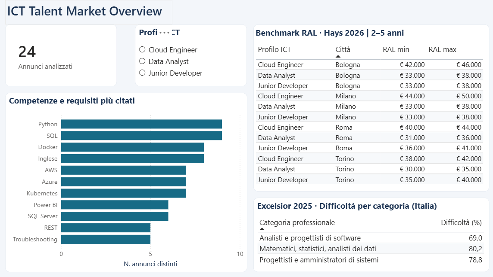
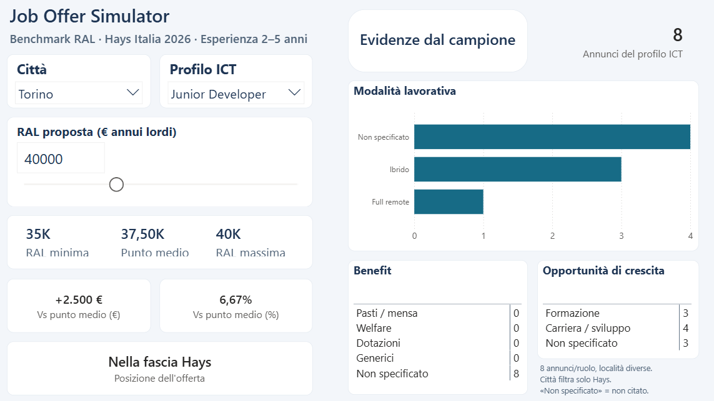

# ICT Talent Acquisition Analytics: Analisi del mercato e competitività delle offerte

## Descrizione del progetto

ICT Talent Acquisition Analytics: Analisi del mercato e competitività delle offerte è un progetto personale di Data Analytics e Business Intelligence, sviluppato come *Proof of Concept* (POC) per esplorare come l'analisi dei dati possa supportare alcune attività di selezione del personale in ambito ICT.

L'obiettivo è organizzare e rendere consultabili informazioni provenienti da fonti differenti, con particolare attenzione alle competenze richieste negli annunci di lavoro, ai benchmark retributivi e alle caratteristiche delle offerte.

Il risultato è un report interattivo realizzato in **Power BI**, composto da due pagine.

## Dati e fonti utilizzate

Il progetto considera tre profili professionali:

- Data Analyst
- Junior Developer
- Cloud Engineer

Sono state utilizzate tre tipologie di informazioni:

- **24 annunci di lavoro pubblicamente consultabili**, raccolti manualmente (8 per ciascun profilo), provenienti da località italiane differenti.
- **Hays Salary Guide Italia 2026**, per i benchmark di retribuzione annua lorda (RAL) relativi a quattro città italiane e alla fascia di esperienza 2–5 anni.
- **Unioncamere Excelsior 2025**, per indicatori nazionali sulla difficoltà di reperimento riferiti a categorie professionali più ampie.

### Fonti originali

- **Annunci di lavoro ICT (24 offerte pubbliche):** gli URL originali, le aziende e i profili professionali sono documentati nel [Registro delle fonti](data/Registro_fonti_ICT_Talent_Acquisition_Analytics.xlsx). Gli annunci sono stati selezionati manualmente e costituiscono un campione esplorativo, non rappresentativo del mercato del lavoro italiano. I collegamenti originali potrebbero cambiare o non essere più disponibili nel tempo.
- **Hays Italia – Salary Guide 2026:** [Report ufficiale](https://www.hays.it/salary-guide/overview). Benchmark RAL relativi ai tre profili ICT, fascia di esperienza 2–5 anni, pagine 67 e 70.
- **Unioncamere – Sistema Informativo Excelsior, Laureati e lavoro – Indagine 2025:** [Rapporto originale (PDF)](https://excelsior.unioncamere.net/sites/default/files/pubblicazioni/2025/Laureati_e_lavoro.pdf). Indicatori nazionali di difficoltà di reperimento, pagina 30.

I dati estratti dalle fonti sono stati organizzati e utilizzati a fini esplorativi. Le rispettive granularità e i limiti di interpretazione sono descritti nel progetto.

## Attività svolte

Durante lo sviluppo del progetto ho lavorato su:

- Raccolta, organizzazione e verifica dei dati.
- Pulizia e preparazione dei dataset con Python (pandas) e Power Query.
- Normalizzazione delle denominazioni delle competenze, mantenendo traccia dei termini originali.
- Classificazione manuale delle informazioni qualitative presenti negli annunci, tra cui modalità lavorativa, benefit e opportunità di crescita.
- Organizzazione del modello dati in Power BI.
- Creazione di misure DAX per il calcolo e il confronto degli indicatori.
- Realizzazione delle visualizzazioni e verifica del funzionamento dei filtri e del simulatore.

## Dashboard Power BI

### 1. ICT Talent Market Overview

La prima pagina offre una panoramica esplorativa dei tre profili ICT attraverso:

- Numero di annunci analizzati.
- Competenze e requisiti più frequentemente citati, conteggiati per annuncio distinto.
- Fasce retributive Hays per profilo e città.
- Indicatori nazionali Excelsior sulla difficoltà di reperimento.

Un filtro consente di approfondire i singoli profili professionali.

### 2. Job Offer Simulator

La seconda pagina permette di simulare una proposta di RAL e confrontarla con il benchmark Hays relativo al profilo e alla città selezionati.

Il simulatore calcola:

- RAL minima, massima e punto medio della fascia.
- Scostamento della proposta dal punto medio, in euro e in percentuale.
- Posizionamento dell'offerta sotto, all'interno o sopra la fascia Hays.

La pagina mostra inoltre le informazioni qualitative rilevate negli annunci del profilo selezionato.

## Limiti dell'analisi

- Il progetto ha finalità esplorative e dimostrative.
- Il campione di 24 annunci è limitato e non statisticamente rappresentativo del mercato del lavoro ICT italiano.
- I benchmark Hays sono riferimenti esterni: l'edizione 2026 utilizza informazioni di mercato raccolte nel 2025 e non costituisce una previsione delle retribuzioni future.
- Gli indicatori Excelsior riguardano categorie professionali nazionali più ampie e non devono essere interpretati come percentuali specifiche per singola città o ruolo.
- Il simulatore consente un confronto descrittivo tra una proposta retributiva e i benchmark Hays, senza valutare la competitività complessiva dell'offerta né prevedere l'esito di una selezione.
- Le informazioni qualitative sono ricavate dagli annunci raccolti. La dicitura **«Non specificato»** indica che un elemento non è stato menzionato nell'annuncio, non necessariamente che sia assente.

## Possibili sviluppi

Il progetto potrebbe essere ampliato attraverso:

- **Ampliamento del campione e dei profili professionali**: raccolta di un numero maggiore di annunci ed estensione dell'analisi a ulteriori ruoli ICT, attraverso criteri di selezione più strutturati, per approfondire le competenze richieste, le condizioni lavorative e le retribuzioni dichiarate negli annunci, ove disponibili.
- **Analisi retributiva per settore economico:** classificazione delle aziende per settore di attività per confrontare le retribuzioni offerte a parità di profilo professionale tenendo conto di variabili come località ed esperienza richiesta.
- **Monitoraggio delle evoluzioni nel tempo:** aggiornamento periodico dei dati per osservare eventuali cambiamenti nelle competenze richieste, nelle condizioni lavorative e nei livelli retributivi.
- **Classificazione semiautomatica delle informazioni testuali:** introduzione di tecniche di elaborazione del linguaggio naturale (NLP) per supportare l'estrazione e la classificazione dei requisiti e delle informazioni qualitative mantenendo controlli sulla qualità dei risultati.
